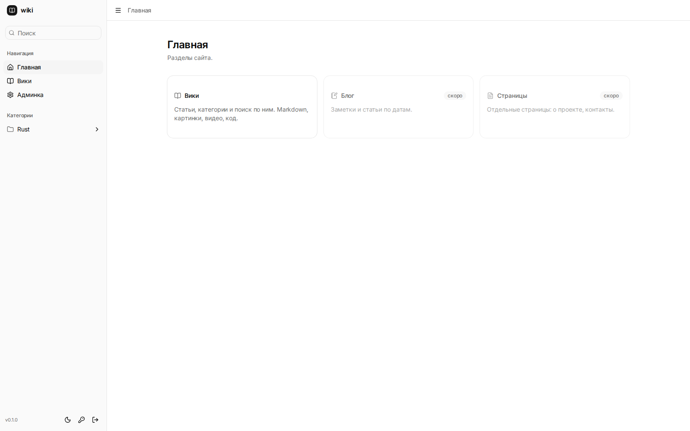
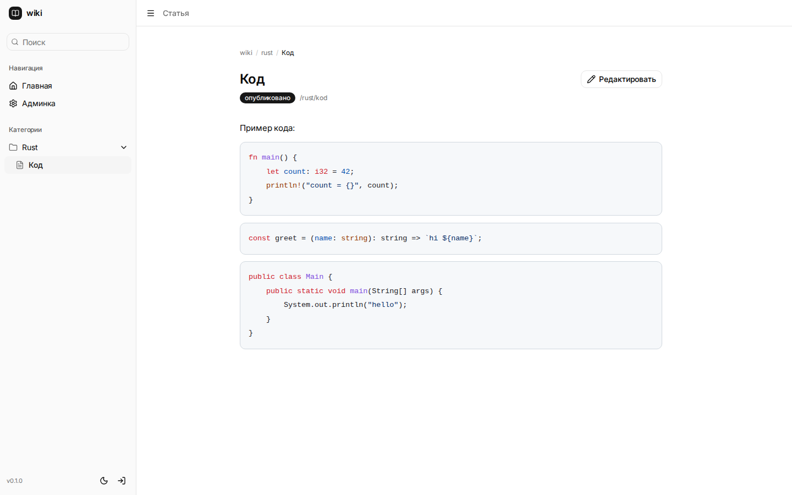

# Synack

Личная база знаний: дерево категорий, статьи в Markdown, поиск, история версий.
Один автор, без внешних сервисов — Rust-бинарник, SQLite и статика.



## Что умеет

- **Дерево категорий** произвольной вложенности и страницы внутри них.
- **Markdown** с серверным рендером и санитайзом: таблицы, списки задач, врезки
  `:::note/tip/warning/caution`, видео `::video{}` и `::youtube{}`, картинки.
- **Редактор** на CodeMirror 6: подсветка Markdown и кода, отмена/повтор,
  вставка картинки, видео, таблицы, ссылки, врезки; конвертация HTML из буфера в Markdown.
- **Черновики** в браузере: текст не теряется при обновлении страницы.
- **Поиск** на SQLite FTS5 с подсветкой совпадений в сниппетах.
- **История версий**: каждое сохранение — снимок, можно посмотреть и откатить.
- **Подсветка кода** (highlight.js) и **якоря заголовков** — светлая и тёмная темы.
- **Авторизация**: argon2id, сессии в HttpOnly cookie, смена пароля в админке.



## Стек

| Слой | Технологии |
|---|---|
| Бэкенд | Rust, axum 0.8, tokio, sqlx 0.8 (SQLite, WAL), argon2, pulldown-cmark, ammonia |
| Фронтенд | SvelteKit 3, Svelte 5 (runes), Tailwind 4, shadcn-svelte, CodeMirror 6 |
| Сборка | `adapter-static` (SPA), `rust-embed` вшивает `dashboard/build` в бинарник |

## Структура

```
src/
  main.rs      сборка роутера, статика, /health
  error.rs     AppError
  auth.rs      вход, сессии, смена пароля, guard
  media.rs     загрузка и отдача файлов
  wiki/mod.rs  категории, страницы, поиск, версии, рендер
dashboard/     SvelteKit-приложение
migrations/    SQL-миграции (вшиваются в бинарник)
deploy/        systemd, Caddy, скрипт деплоя
docs/          документация (stack.md — решения по стеку, deploy.md — установка)
e2e/           Playwright-сценарии
scripts/       dev-скрипты, тесты, одноразовые патчи
```

## Быстрый старт

Нужны Rust, `cargo-watch`, Bun и headless Chromium для тестов.

```bash
# бэкенд с автоперезапуском
./scripts/dev-rust.sh

# фронтенд отдельно
cd dashboard && bun install && bun run dev
```

- API: `http://127.0.0.1:3000`
- UI: `http://localhost:5173`

Первый запуск создаёт учётку `admin` / `admin` — в админке сверху висит баннер,
пока пароль не сменён.

### Сборка

```bash
cd dashboard && bun run build
cd .. && cargo build --release   # бинарник вшивает SPA
./target/release/wiki
```

Переменные окружения: `WIKI_ADDR`, `WIKI_DB`, `WIKI_MEDIA`, `WIKI_PASSWORD_HASH`.

## Деплой

Пошагово — в [docs/deploy.md](docs/deploy.md): systemd-юнит, Caddy с автоматическим
HTTPS, бэкап базы и медиа.

## Лицензия

MIT — см. [LICENSE](LICENSE).
